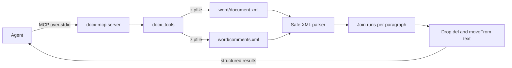

# docx-mcp

**[Read the wiki](https://github.com/dboles99/docx-mcp/wiki)** for how it works, the evidence, the design decisions and the limits.

A read-only MCP server that lets an AI agent read and search a Word document as it would stand with every tracked change accepted.

**简体中文：** docx-mcp 是一个只读的 MCP 服务器，让 AI 智能体读取和搜索 Word 文档。它返回接受全部修订后的文本，已删除的内容不会被当作正文，文件本身不会被修改。

**繁體中文：** docx-mcp 是一個唯讀的 MCP 伺服器，讓 AI 代理讀取與搜尋 Word 文件。它回傳接受全部修訂後的文字，已刪除的內容不會被當成內文，檔案本身不會被修改。

Designed and authored by Daniel Boles; implemented with coding agents.

## What it does

Most DOCX readers were written for clean documents. Point one at a file with tracked changes and it can report deleted words as text, or drop pending insertions, and nothing tells you. An agent working from that text is wrong and sounds sure of itself.

This server gives an agent six tools. None of them can write.

| Tool | Purpose |
| --- | --- |
| `read_docx_accepted_text` | Paginated paragraphs of accepted text. |
| `find_docx_term` | Regex search over accepted text, with context. |
| `check_docx_term_variants` | Count each spelling of a term and say where it appears. |
| `get_docx_structure_stats` | Paragraph, word, tracked-change and comment counts. |
| `scan_docx_meta_notes` | Find working notes such as `TODO:` left at the start of a document. |
| `list_docx_paragraph_range` | Read a known range of paragraphs by index. |



## Quick start

Python 3.12 or newer.

```bash
git clone https://github.com/dboles99/docx-mcp.git
cd docx-mcp
python -m venv .venv
.venv/bin/pip install -e ".[dev]"     # Windows: .venv\Scripts\pip
.venv/bin/python examples/call_over_stdio.py
```

`call_over_stdio.py` builds an invented DOCX in a temporary folder, starts the server as a subprocess, and calls it through the MCP client. Its output:

```text
tools: check_docx_term_variants, find_docx_term, get_docx_structure_stats, list_docx_paragraph_range, read_docx_accepted_text, scan_docx_meta_notes
stats: {"comment_count": 0, "file_size_kb": 1.1, "has_tracked_changes": true, "paragraph_count": 4, "tracked_change_paragraph_count": 1, "word_count_approx": 31}
accepted: The pilot covered twelve sites and met its target in the first year.
search for deleted word: 0 hits
variants: {"cyber security": 1, "cybersecurity": 1}
notes: TODO: check the figures before this goes out.
```

### Register it in an MCP client

Most clients take a block like `examples/mcp-client-config.json`:

```json
{
  "mcpServers": {
    "docx": {
      "command": "docx-mcp",
      "args": []
    }
  }
}
```

If `docx-mcp` is not on the client's `PATH`, give the full path to the script inside your virtual environment. With Claude Code:

```bash
claude mcp add docx -- docx-mcp
```

### Use it without MCP

```python
from docx_mcp import find_term, read_accepted_text

rows = read_accepted_text("report.docx", limit=20)
hits = find_term("report.docx", r"carbon (tax|levy)")
```

## Design notes

- **Accepted text.** Insertions are included. `w:del` and `w:moveFrom` are excluded at any depth, by walking the tree, not by pattern-matching the XML.
- **Split runs.** Word divides sentences across runs for formatting and spell-check reasons. Text is joined per paragraph first, so a phrase that crosses runs is still found.
- **Stable addresses.** `para_index` is a paragraph's position in the document, not in a result page, so an agent can page, search and then jump back to the same place.
- **Could not read is not nothing found.** A missing or damaged file raises in Python and is a readable tool error over MCP. It does not return an empty list.
- **Untrusted files.** The XML parser does not resolve entities, load a DTD or use the network, and any XML part over 256 MB when decompressed is refused.
- **Dependencies.** Only `lxml` and the MCP SDK. The DOCX logic in `docx_tools.py` does not import the SDK and works on its own.

## Limits

- It reads the document body, including tables and text boxes. Headers, footers, footnotes and endnotes are not read.
- Comments are counted, not read.
- Accepted text is per paragraph. A tracked deletion of a paragraph mark does not merge the two paragraphs.
- Field results are read as stored text and are not recalculated.
- `find_docx_term` runs the caller's regular expression with no time limit, so a pathological pattern can stall the server.
- The server reads any path its process can read. Run it with an account that can reach only what the agent should see.
- `word_count_approx` splits on whitespace, so it undercounts text with no spaces, such as Chinese or Japanese.
- It does not open legacy `.doc` files.
- Fixtures are generated in code. Tested on Windows with Python 3.12. Not tested on Linux or macOS, or with a file saved by Word itself.

## Tests

```bash
pytest
```

Last run, on Windows with Python 3.12: 67 passed.

Every fixture is an invented document built in code, and no DOCX file is stored in this repository. The tests include a real subprocess round trip over stdio. As a one-off check, the example document was also read with `pandoc --track-changes=accept`, which gave the same text.

## Licence

Apache-2.0. Copyright 2026 Daniel Boles. See [LICENSE](LICENSE).
